# Knowledge graph: taxonomy đã xác minh (chưa phải graph internal links thực tế)

Nguồn: `data/content-taxonomy.json` tại `ea7c82f57185eb85487bb61287ff3539d8e41ce9`; 7 parent, 56 child. Cạnh là quan hệ taxonomy, **không** khẳng định có hyperlink thực trên HTML.

```mermaid
flowchart TD
    H["Homepage / - Core navigation"]
    P_THUE_XE["Thuê xe máy Hà Nội · /thue-xe/"]
    H --> P_THUE_XE
    P_XE_MAY["Xe máy & dòng xe · /xe-may/"]
    H --> P_XE_MAY
    P_PHAP_LY["An toàn & pháp lý · /an-toan-phap-ly/"]
    H --> P_PHAP_LY
    P_DU_LICH["Du lịch Hà Nội · /du-lich/"]
    H --> P_DU_LICH
    P_CUNG_DUONG["Cung đường & hành trình · /cung-duong/"]
    H --> P_CUNG_DUONG
    P_KY_NANG["Kỹ năng & tình huống · /ky-nang/"]
    H --> P_KY_NANG
    P_HOI_DAP["Hỏi đáp thuê xe máy · /hoi-dap/"]
    H --> P_HOI_DAP
    C_THUE_GIA["Giá thuê xe máy · /thue-xe/gia-thue/"]
    P_THUE_XE --> C_THUE_GIA
    C_THUE_THU_TUC["Thủ tục thuê xe · /thue-xe/thu-tuc/"]
    P_THUE_XE --> C_THUE_THU_TUC
    C_THUE_NGAY["Thuê xe theo ngày · /thue-xe/thue-ngay/"]
    P_THUE_XE --> C_THUE_NGAY
    C_THUE_TUAN["Thuê xe theo tuần · /thue-xe/thue-tuan/"]
    P_THUE_XE --> C_THUE_TUAN
    C_THUE_THANG["Thuê xe theo tháng · /thue-xe/thue-thang/"]
    P_THUE_XE --> C_THUE_THANG
    C_THUE_DAT_COC["Đặt cọc & giữ giấy tờ · /thue-xe/dat-coc/"]
    P_THUE_XE --> C_THUE_DAT_COC
    C_THUE_QUOC_TE["Thuê xe cho khách quốc tế · /thue-xe/khach-quoc-te/"]
    P_THUE_XE --> C_THUE_QUOC_TE
    C_THUE_NHAN_TRA["Nhận xe & trả xe · /thue-xe/nhan-tra-xe/"]
    P_THUE_XE --> C_THUE_NHAN_TRA
    C_THUE_SU_CO["Sự cố khi thuê xe · /thue-xe/su-co/"]
    P_THUE_XE --> C_THUE_SU_CO
    C_XE_SO["Xe số · /xe-may/xe-so/"]
    P_XE_MAY --> C_XE_SO
    C_XE_GA["Xe tay ga · /xe-may/xe-ga/"]
    P_XE_MAY --> C_XE_GA
    C_XE_50CC["Xe 50cc · /xe-may/xe-50cc/"]
    P_XE_MAY --> C_XE_50CC
    C_XE_DIEN["Xe máy điện · /xe-may/xe-dien/"]
    P_XE_MAY --> C_XE_DIEN
    C_XE_DAP_DIEN["Xe đạp điện · /xe-may/xe-dap-dien/"]
    P_XE_MAY --> C_XE_DAP_DIEN
    C_HONDA_WAVE["Honda Wave · /xe-may/honda-wave/"]
    P_XE_MAY --> C_HONDA_WAVE
    C_HONDA_VISION["Honda Vision · /xe-may/honda-vision/"]
    P_XE_MAY --> C_HONDA_VISION
    C_HONDA_AIR_BLADE["Honda Air Blade · /xe-may/honda-air-blade/"]
    P_XE_MAY --> C_HONDA_AIR_BLADE
    C_HONDA_CLICK["Honda Click · /xe-may/honda-click/"]
    P_XE_MAY --> C_HONDA_CLICK
    C_YAMAHA_SIRIUS["Yamaha Sirius · /xe-may/yamaha-sirius/"]
    P_XE_MAY --> C_YAMAHA_SIRIUS
    C_BAO_DUONG["Bảo dưỡng xe máy · /xe-may/bao-duong-xe/"]
    P_XE_MAY --> C_BAO_DUONG
    C_GPLX["Giấy phép lái xe · /an-toan-phap-ly/giay-phep-lai-xe/"]
    P_PHAP_LY --> C_GPLX
    C_BAO_HIEM["Bảo hiểm xe máy · /an-toan-phap-ly/bao-hiem/"]
    P_PHAP_LY --> C_BAO_HIEM
    C_NOI_DO_CONG["Nồng độ cồn · /an-toan-phap-ly/noi-do-cong/"]
    P_PHAP_LY --> C_NOI_DO_CONG
    C_PHAT_NGUOI["Phạt nguội · /an-toan-phap-ly/phat-nguoi/"]
    P_PHAP_LY --> C_PHAT_NGUOI
    C_BIEN_BAO["Biển báo giao thông · /an-toan-phap-ly/bien-bao/"]
    P_PHAP_LY --> C_BIEN_BAO
    C_GIAY_TO["Giấy tờ xe & cá nhân · /an-toan-phap-ly/giay-to/"]
    P_PHAP_LY --> C_GIAY_TO
    C_QUY_DINH["Quy định giao thông · /an-toan-phap-ly/quy-dinh-giao-thong/"]
    P_PHAP_LY --> C_QUY_DINH
    C_DIEM_DEN["Điểm đến Hà Nội · /du-lich/diem-den/"]
    P_DU_LICH --> C_DIEM_DEN
    C_BAO_TANG["Bảo tàng · /du-lich/bao-tang/"]
    P_DU_LICH --> C_BAO_TANG
    C_PHO_CO["Phố cổ Hoàn Kiếm · /du-lich/pho-co/"]
    P_DU_LICH --> C_PHO_CO
    C_HO_TAY["Hồ Tây & lân cận · /du-lich/ho-tay/"]
    P_DU_LICH --> C_HO_TAY
    C_LONG_BIEN["Long Biên & Gia Lâm · /du-lich/long-bien/"]
    P_DU_LICH --> C_LONG_BIEN
    C_NGOAI_THANH["Ngoại thành Hà Nội · /du-lich/ngoai-thanh/"]
    P_DU_LICH --> C_NGOAI_THANH
    C_CD_NOI_THANH["Cung đường nội thành · /cung-duong/cung-duong-noi-thanh/"]
    P_CUNG_DUONG --> C_CD_NOI_THANH
    C_CD_CUOI_TUAN["Cung đường cuối tuần · /cung-duong/cung-duong-cuoi-tuan/"]
    P_CUNG_DUONG --> C_CD_CUOI_TUAN
    C_CD_MAI_CHAU["Mai Châu · /cung-duong/mai-chau/"]
    P_CUNG_DUONG --> C_CD_MAI_CHAU
    C_CD_MOC_CHAU["Mộc Châu · /cung-duong/moc-chau/"]
    P_CUNG_DUONG --> C_CD_MOC_CHAU
    C_CD_HA_GIANG["Hà Giang · /cung-duong/ha-giang/"]
    P_CUNG_DUONG --> C_CD_HA_GIANG
    C_CD_PHO_BAC["Cung đường các tỉnh phía Bắc · /cung-duong/cung-duong-pho-bac/"]
    P_CUNG_DUONG --> C_CD_PHO_BAC
    C_KY_NANG_CO_BAN["Kỹ năng lái cơ bản · /ky-nang/ky-nang-lai-co-ban/"]
    P_KY_NANG --> C_KY_NANG_CO_BAN
    C_KY_NANG_TINH_HUONG["Tình huống giao thông · /ky-nang/tinh-huong-giao-thong/"]
    P_KY_NANG --> C_KY_NANG_TINH_HUONG
    C_KY_NANG_THOI_TIET["Thời tiết & đường sá · /ky-nang/thoi-tiet-va-duong-sa/"]
    P_KY_NANG --> C_KY_NANG_THOI_TIET
    C_KY_NANG_CHO_DO["Chở đồ & hành lý · /ky-nang/cho-do-va-hanh-ly/"]
    P_KY_NANG --> C_KY_NANG_CHO_DO
    C_KY_NANG_GUI_XE["Gửi xe & giữ xe · /ky-nang/gui-xe-va-giu-xe/"]
    P_KY_NANG --> C_KY_NANG_GUI_XE
    C_KY_NANG_SUC_KHOE["Sức khỏe khi lái xe · /ky-nang/suc-khoe-khi-lai-xe/"]
    P_KY_NANG --> C_KY_NANG_SUC_KHOE
    C_HD_GIA["Hỏi đáp về giá · /hoi-dap/hoi-dap-gia/"]
    P_HOI_DAP --> C_HD_GIA
    C_HD_THU_TUC["Hỏi đáp thủ tục · /hoi-dap/hoi-dap-thu-tuc/"]
    P_HOI_DAP --> C_HD_THU_TUC
    C_HD_PHAP_LY["Hỏi đáp pháp lý · /hoi-dap/hoi-dap-phap-ly/"]
    P_HOI_DAP --> C_HD_PHAP_LY
    C_HD_CHON_XE["Hỏi đáp chọn xe · /hoi-dap/hoi-dap-chon-xe/"]
    P_HOI_DAP --> C_HD_CHON_XE
    C_HD_SU_CO["Hỏi đáp sự cố · /hoi-dap/hoi-dap-su-co/"]
    P_HOI_DAP --> C_HD_SU_CO
    C_HD_NGUOI_MOI["Hỏi đáp người mới · /hoi-dap/hoi-dap-nguoi-moi/"]
    P_HOI_DAP --> C_HD_NGUOI_MOI
    C_THUE_DOI_TUONG["Thuê xe theo đối tượng · /thue-xe/thue-theo-doi-tuong/"]
    P_THUE_XE --> C_THUE_DOI_TUONG
    C_THUE_DIA_DIEM["Thuê xe theo địa điểm · /thue-xe/thue-theo-dia-diem/"]
    P_THUE_XE --> C_THUE_DIA_DIEM
    C_XE_LUA_CHON["Chọn loại xe khi thuê · /xe-may/chon-loai-xe/"]
    P_XE_MAY --> C_XE_LUA_CHON
    C_XE_KHAC_PHUC["Xử lý sự cố xe máy thuê · /xe-may/xu-ly-su-co-xe/"]
    P_XE_MAY --> C_XE_KHAC_PHUC
    C_XE_SO_SANH["So sánh khi thuê xe máy · /xe-may/so-sanh-xe/"]
    P_XE_MAY --> C_XE_SO_SANH
```

